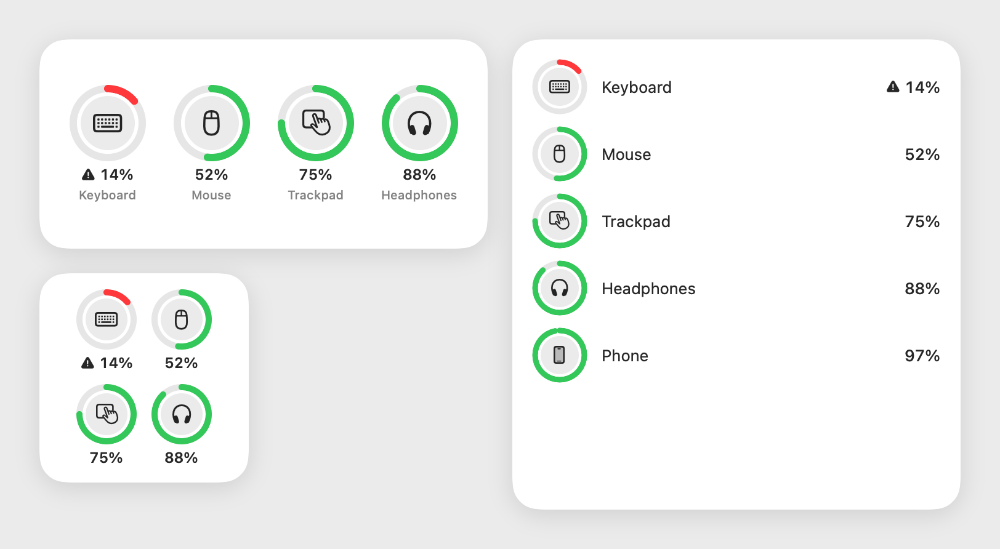
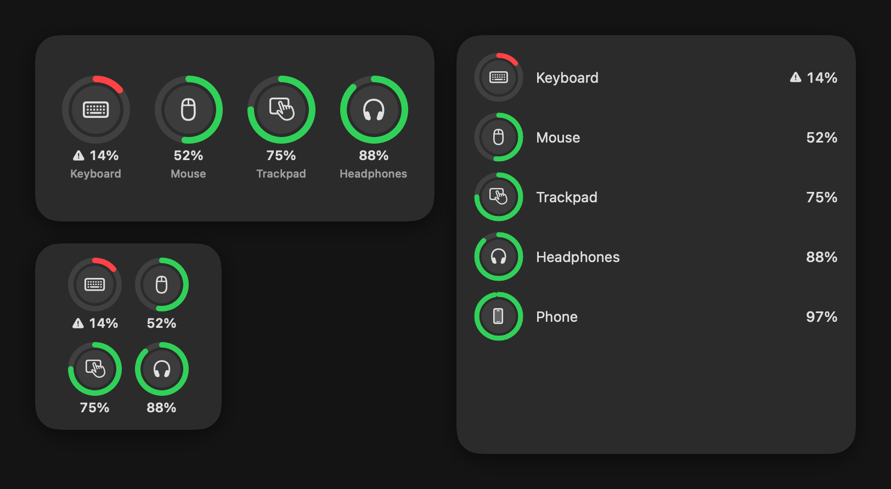

# Juice

The battery level of every Bluetooth device connected to your Mac — keyboard,
mouse, trackpad, headphones, phone — in the menu bar, in a widget, and in a
notification before one runs out.

## What It Does

- **A battery icon in the menu bar.** The icon fills to the lowest level among
  your connected devices and turns red when one is low; its menu lists each
  device with its own level.
- **Several batteries, one device.** A device with more than one battery
  (earbuds and their case) is listed by its lowest level, with the parts shown
  beside it.
- **A widget in three sizes.** Small, medium and large WidgetKit widgets show the
  same devices; add one from *Edit Widgets*.
- **A notification at your threshold.** When a device falls to the threshold
  (20% by default, 5–95% in the window) Juice sends one notification for it.
  That device alerts again only after it has charged 5 points above the
  threshold, so a level that wobbles by one does not repeat itself.
- **Reads every source.** The system's own battery property, a keyboard's HID
  battery report, and the standard Bluetooth LE battery characteristic.
  Some keyboards report their battery only as a HID report, which macOS lets an
  app read after you grant Juice *Input Monitoring* (System Settings › Privacy &
  Security); the window offers a shortcut when it is missing.
- **Updates itself** from this repository's releases through Sparkle, and asks
  before installing.

Requires macOS 14 or newer.

## Install

Download `Juice-<version>-macos.dmg` from the
[latest release](https://github.com/leechoonguk/juice/releases/latest), open it
and drag Juice to Applications. Juice lives in the menu bar; open its window
from the menu to set the threshold.

## Build From Source

Everything runs through the `Makefile` in this directory; `make help` lists
every target. You need Node 22.18 or newer, Xcode and CocoaPods.

| Need | Command |
|---|---|
| Install dependencies | `make install` (npm packages and macOS pods) |
| Run | `make start` in one terminal, then `make run` |
| Build only | `make build` |
| Read your devices' batteries from the terminal | `make battery-probe` |
| Check while working | `make lint`, `make typecheck`, `make test`, `make swift-check`, `make swift-test` |
| Re-render the widget pictures above | `make widget-snapshots` |
| The whole gate | `make verify` |

## How It Fits Together

A React-free Swift engine does the work. Like Apple's own Batteries widget, it
reads when the system says a level may have changed — the accessory
power-source notifications, a Bluetooth connection or disconnection, wake — and
an LE device that can notify announces its own changes. Only what never
announces anything (a keyboard's HID battery report) waits for a backstop read
after a quiet quarter-hour; opening the menu reads again when the last read is
over a minute old. It publishes the result to an App Group container, and
notifies when a device runs low. The menu bar item is
part of that engine. The window is a React Native (react-native-macos) view of
the same snapshot, reaching the engine through one typed wrapper
(`app/src/native/juiceBattery.ts`). The widget, a separate sandboxed process,
only displays the snapshot the app last published.

| Path | What lives there |
|---|---|
| `app/src/` | the window: screen, display helpers, typed native wrappers |
| `app/macos/Juice-macOS/Native/Core/` | the battery engine, the menu bar item and the update request |
| `app/macos/Shared/` | the snapshot types the app and the widget share |
| `app/macos/JuiceWidget/` | the WidgetKit extension |
| `app/macos/CoreTests/` | Swift tests and the `juice-probe`, `juice-icon` and `juice-widget-snapshots` tools |
| `.omp/` | the project's agent harness: rules, hooks and the `make verify` gate |
